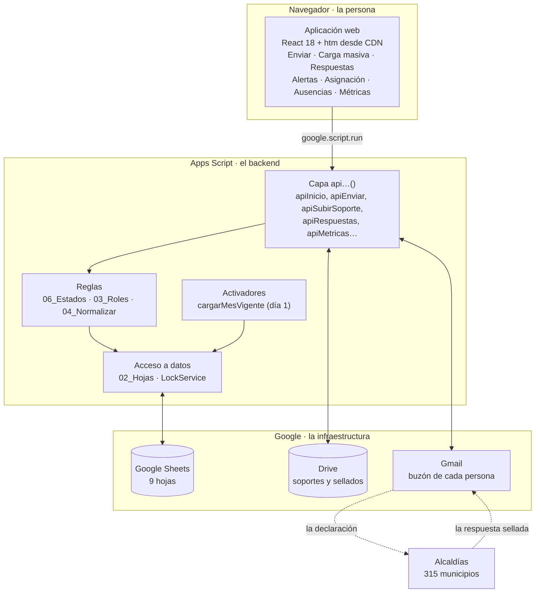
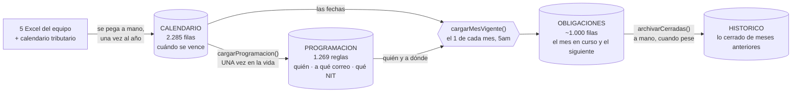
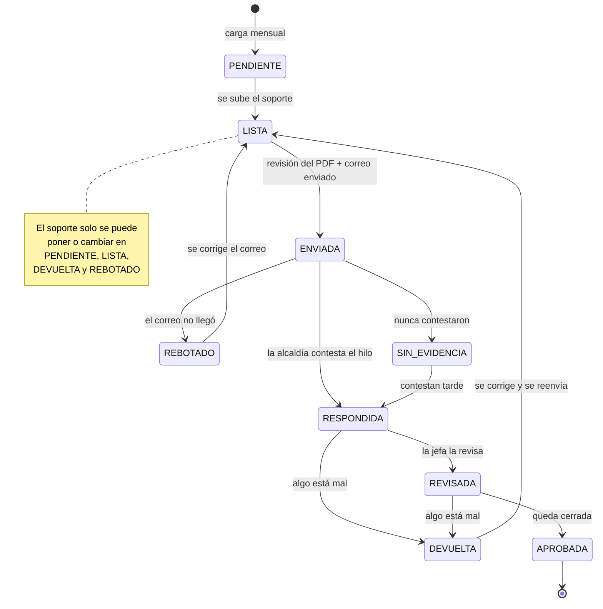
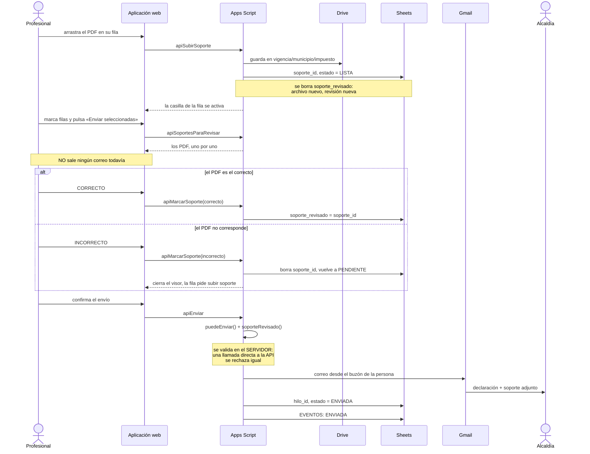
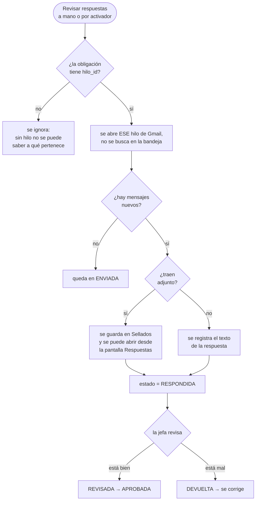
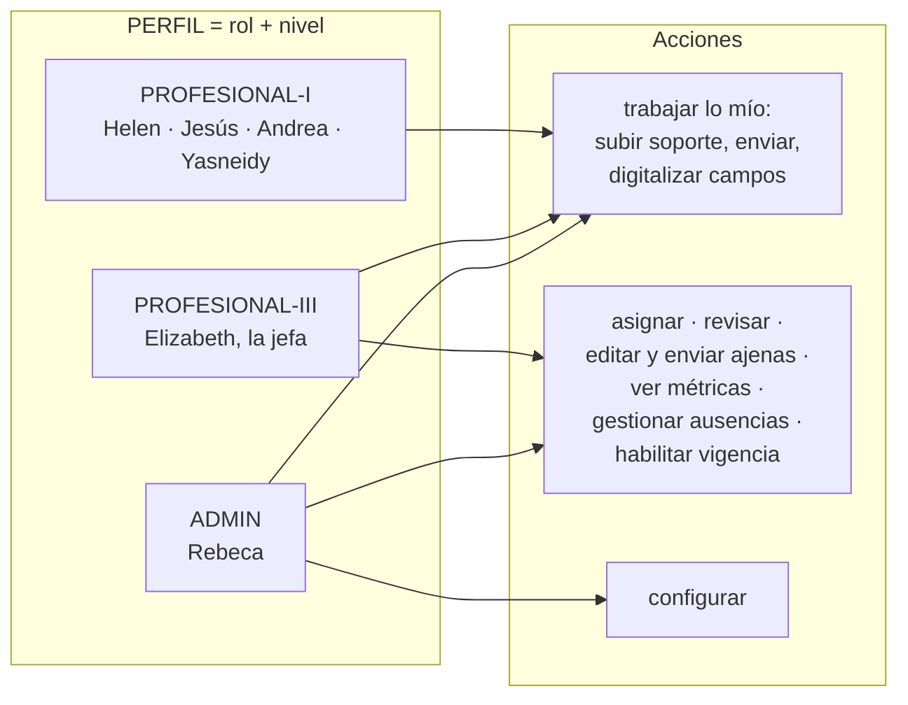
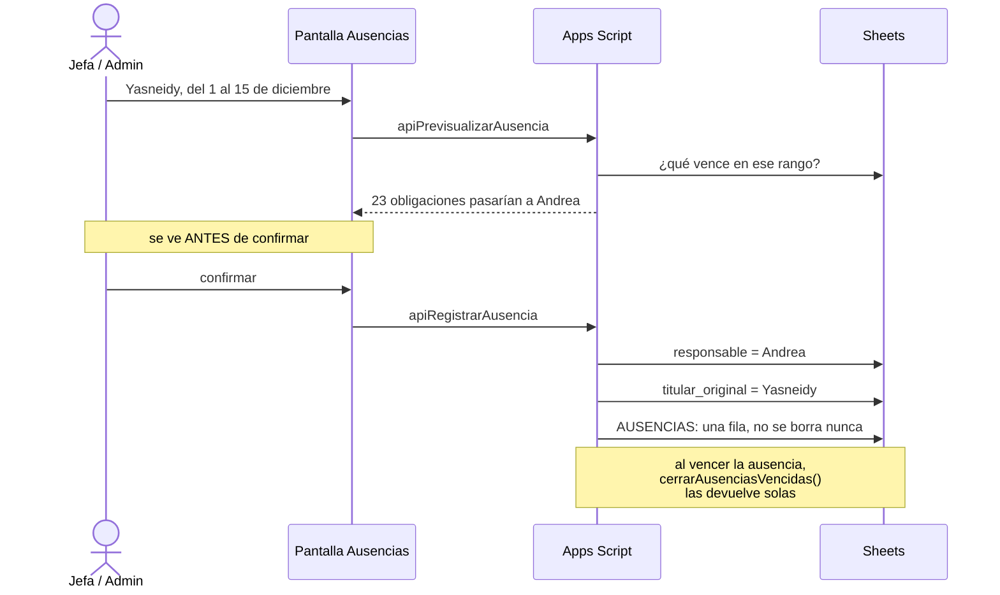
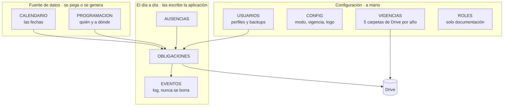

# SINAV · arquitectura y flujos

Los diagramas están en Mermaid, que GitHub dibuja solo al abrir este archivo.
Si los ves como texto, es que los estás mirando en un editor sin Mermaid.

- [1 · Arquitectura](#1--arquitectura-de-donde-sale-cada-cosa)
- [2 · De dónde salen las obligaciones](#2--de-donde-salen-las-obligaciones)
- [3 · Estados de una obligación](#3--estados-de-una-obligacion-uml-de-estados)
- [4 · Envío de una declaración](#4--envio-de-una-declaracion-uml-de-secuencia)
- [5 · La respuesta de la alcaldía](#5--la-respuesta-de-la-alcaldia)
- [6 · Permisos](#6--permisos-quien-puede-que)
- [7 · Ausencias y backups](#7--ausencias-y-backups)
- [8 · Las hojas y quién escribe en cada una](#8--las-hojas-y-quien-escribe-en-cada-una)

---

## 1 · Arquitectura: de dónde sale cada cosa

No hay servidor propio ni base de datos: todo vive dentro de la cuenta de
Google del banco. El Sheets **es** la base de datos, Apps Script **es** el
backend, y la aplicación web se sirve desde el mismo proyecto.

**Lo que hay que entender de este dibujo:**

- La interfaz **nunca** toca las hojas. Todo pasa por la capa `api…()`, y ahí
  se valida el permiso. Esconder un botón no es seguridad.
- El despliegue es **«ejecutar como el usuario que accede»**. Por eso el correo
  sale del buzón de cada quien, con su cuota, y la respuesta llega a su
  bandeja. Es la pieza que haría difícil mover esto a otra tecnología.
- El activador del día 1 escribe en las hojas **sin que nadie esté
  conectado**, con la cuenta de quien lo instaló.

---

## 2 · De dónde salen las obligaciones

El año entero son 6.320 obligaciones, y el libro las lee todas en cada
pantalla aunque después se filtren. Por eso OBLIGACIONES guarda **el mes en
curso y el siguiente**, no el año.

**El criterio es la fecha de vencimiento, no el periodo.** Lo que toca
trabajar en noviembre es lo que se vence en noviembre, aunque el periodo
declarado sea de octubre.

---

## 3 · Estados de una obligación (UML de estados)

Lo que no está en este grafo **no pasa**: `validarPaso()` rechaza cualquier
salto que no esté dibujado aquí.

`APROBADA` no tiene salida: es el final. Y de `PENDIENTE` solo se sale
subiendo el soporte — **sin soporte no hay envío, sin excepción**.

---

## 4 · Envío de una declaración (UML de secuencia)

Aquí está la parte que más se ha tocado, y la que conviene no deshacer: **la
revisión del PDF es la última puerta, no la primera**.

---

## 5 · La respuesta de la alcaldía

**Por qué el hilo y no una búsqueda en la bandeja:** el hilo ya dice a qué
obligación pertenece la respuesta. Buscar por asunto o por remitente sería
adivinar, y una declaración sellada archivada en el municipio equivocado es un
error que se descubre meses después.

---

## 6 · Permisos: quién puede qué

El permiso se valida **en el servidor**, en `exige()`, dentro de cada
`api…()`. La interfaz esconde botones por comodidad, no por seguridad.

Quien entra por primera vez con un correo del dominio se da de alta solo como
`PROFESIONAL-I`. Subir a alguien de nivel es a mano, en la hoja USUARIOS.

---

## 7 · Ausencias y backups

El backup sale de la columna `backup` de USUARIOS, y si está vacía, de los
pares del código: **Andrea ↔ Yasneidy** y **Jesús ↔ Helen**. La hoja manda
sobre el código, para poder cambiarlo sin tocar nada.

---

## 8 · Las hojas y quién escribe en cada una

| Hoja | Para qué | Quién la toca |
|---|---|---|
| **CALENDARIO** | Las fechas de vencimiento. No la lee la interfaz | Se pega una vez al año |
| **PROGRAMACION** | Quién responde, a qué correo, qué NIT | A mano, cuando algo cambia |
| **OBLIGACIONES** | El mes en curso y el siguiente | El activador la llena, la app la mueve |
| USUARIOS | Quién entra, su perfil, su backup | A mano |
| ROLES | Qué puede cada perfil. Documentación | Nadie |
| VIGENCIAS | Los 5 ids de carpetas de Drive por año | Al habilitar un año |
| AUSENCIAS | Vacaciones y traspasos. No se borra | La app |
| CONFIG | Modo PRUEBA/PRODUCCION, vigencia, logo | A mano |
| EVENTOS | El log de todo. Append-only | La app |
| HISTORICO | Lo cerrado que se archivó. Aparece sola | `archivarCerradas()` |
