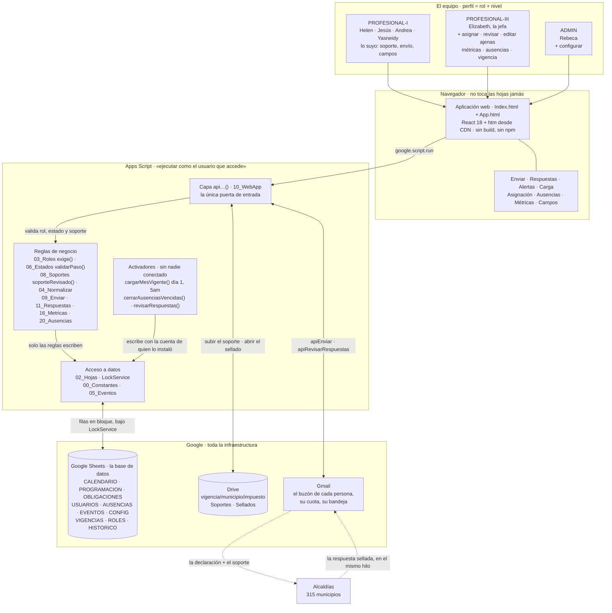
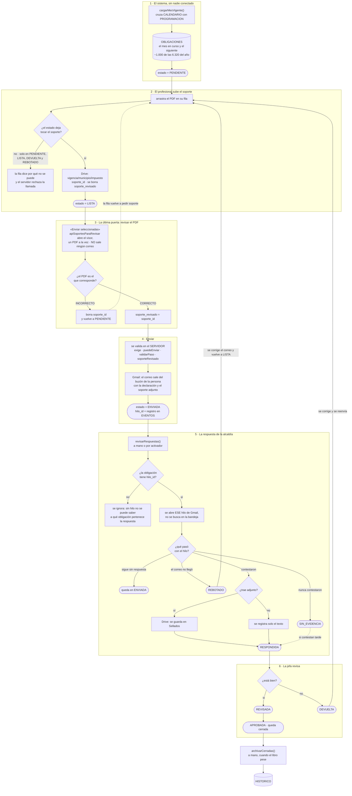
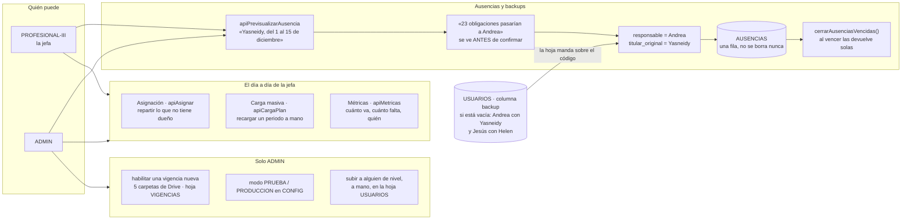

# SINAV

**Control de obligaciones tributarias territoriales**
· Departamento de Impuestos, Banco Davivienda

SINAV lleva cada declaración territorial del banco desde que el calendario dice
que se vence hasta que la alcaldía devuelve el sellado, con evidencia de cada
paso y sin que nadie tenga que acordarse de nada.

No hay servidor propio ni base de datos: todo vive dentro de la cuenta de Google
del banco. El Sheets **es** la base de datos, Apps Script **es** el backend, y
la aplicación web se sirve desde el mismo proyecto.

| | |
|---|---|
| **Qué hay que atender** | 315 municipios y 4 entidades, 6.320 obligaciones al año |
| **Quién** | 4 profesionales, una jefa de equipo y un administrador |
| **Impuestos** | RETEICA, AUTORRETEICA, ICA y EXÓGENA |
| **Dónde** | Google Sheets + Apps Script + una aplicación web, dentro del dominio |
| **Qué no hay** | Servidor, base de datos, licencias, despliegues |

**Lo demás:** [manual operativo](docs/MANUAL-OPERATIVO.md) — instalar, operar,
depurar y desarrollar · [ARQUITECTURA.md](ARQUITECTURA.md) — los diagramas de
estados y secuencia · [DESIGN.md](DESIGN.md) — decisiones visuales.

---

## Índice

- [El problema que resuelve](#el-problema-que-resuelve)
- [El recorrido de una obligación](#el-recorrido-de-una-obligación)
- [La arquitectura](#la-arquitectura)
- [El flujo, con sus caminos malos](#el-flujo-con-sus-caminos-malos)
- [Los otros escenarios](#los-otros-escenarios)
- [Quién puede qué](#quién-puede-qué)
- [Los datos: las hojas](#los-datos-las-hojas)
- [Dónde se guardan los PDF](#dónde-se-guardan-los-pdf)
- [Cómo se nombran los PDF](#cómo-se-nombran-los-pdf)
- [Quién responde por cada obligación](#quién-responde-por-cada-obligación)
- [Qué hace cada archivo](#qué-hace-cada-archivo)
- [Decisiones que conviene no deshacer](#decisiones-que-conviene-no-deshacer)
- [Lo que falta](#lo-que-falta)

---

## El problema que resuelve

Cada municipio donde el banco tiene oficina cobra sus propios impuestos, con sus
propias fechas. Son 315 calendarios distintos y más de seis mil vencimientos al
año, repartidos entre cuatro personas, y la evidencia de que algo se presentó es
un correo con un PDF adjunto perdido en una bandeja.

Lo que SINAV cambia:

| Antes | Con SINAV |
|---|---|
| Cada quien lleva su propio Excel | Un solo maestro, OBLIGACIONES |
| El vencimiento se recuerda | El día 1 aparece solo lo que vence este mes |
| El soporte se adjunta a mano | Se arrastra el PDF y se guarda en la carpeta del municipio |
| Se envía y se confía | El PDF se revisa en pantalla antes de que salga el correo |
| La respuesta se busca en la bandeja | Se lee **ese** hilo, el mismo por el que salió |
| «¿Quién mandó esto y cuándo?» | EVENTOS, append-only, con fecha y autor |

---

## El recorrido de una obligación

Cada paso se valida en el servidor; la interfaz solo apaga botones.

**1 · Aparece.** El día 1 de cada mes la carga mensual trae del CALENDARIO lo
que vence ese mes y el siguiente, y lo escribe en OBLIGACIONES en `PENDIENTE`.
El responsable sale de la matriz de distribución; si no se pudo resolver, queda
sin dueño y aparece en Asignación.

**2 · Se asigna.** La jefa o el admin reparten lo que no tiene dueño. El
profesional la ve en su lista y en sus alertas.

**3 · Se completa la plata.** `valor`, `forma_pago` (PSE, ventanilla,
transferencia…) y `paga_quien`. Sin esos datos el envío no se habilita.

**4 · Se sube el soporte.** El profesional arrastra el PDF en su fila, o varios
de golpe en **Carga masiva**, donde se emparejan por el código DANE del nombre
del archivo. El archivo queda en `<vigencia>/<municipio>/<impuesto>/` y la
obligación pasa a `LISTA`.

**5 · Se selecciona.** Con soporte, estado correcto y correo de la oficina, la
casilla de la fila se activa. Sin eso, no.

**6 · Se revisa el soporte. Obligatorio.** Al darle a *Enviar seleccionadas* no
sale ningún correo todavía: se abre el visor con cada PDF, uno por uno, y hay
que marcarlo **Correcto** o **Incorrecto**.

**7 · Último check y envío.** Al confirmar, el correo sale **desde la cuenta de
quien está usando la herramienta**, se guarda el `hilo_id` de Gmail y la
obligación pasa a `ENVIADA`.

**8 · Contesta la oficina.** Si responden sobre el mismo correo, la pestaña
**Respuestas** recoge el mensaje y el adjunto, lo guarda en Sellados y lo deja
abrible desde ahí. La obligación pasa a `RESPONDIDA`.

**9 · Se cierra.** La jefa o el admin la marcan `APROBADA`. Sale de todo lo
abierto y queda solo en métricas.

**Si alguien se va:** su backup recibe las obligaciones del rango de la
ausencia, con `titular_original` guardado para devolvérselas al regreso.

---

## La arquitectura

Los diagramas están en Mermaid, que GitHub dibuja solo al abrir este archivo. Si
los ves como texto, es que los estás mirando en un editor sin Mermaid.



Tres cosas que hay que entender de este dibujo:

- **La interfaz nunca toca las hojas.** Todo entra por `api…()`, y ahí se valida
  el permiso con `exige()`. Esconder un botón no es seguridad: una llamada
  directa a la API se rechaza igual.
- **El despliegue es «ejecutar como el usuario que accede».** Por eso el correo
  sale del buzón de cada quien, con su cuota, y la respuesta llega a su bandeja.
  Es la pieza que haría difícil mover esto a otra tecnología.
- **El activador del día 1 escribe sin que nadie esté conectado**, con la cuenta
  de quien lo instaló. Si esa cuenta se desactiva, deja de correr y no avisa.

---

## El flujo, con sus caminos malos



`APROBADA` no tiene salida: es el final. Lo que no está en ese grafo **no pasa**
— `validarPaso()` rechaza cualquier salto que no esté dibujado. Y de `PENDIENTE`
solo se sale subiendo el soporte: **sin soporte no hay envío, sin excepción**.

### Por qué la revisión del PDF va al final

Un PDF con el nombre correcto puede llevar dentro la declaración de otro
municipio. Pasa al arrastrar el archivo equivocado o al renombrar mal, y no se
descubre hasta que la oficina lo recibe.

El visto bueno es **del documento, no de la obligación**: la columna
`soporte_revisado` guarda los `soporte_id` que se miraron, no un SI/NO. Si
alguien reemplaza el archivo, deja de coincidir y hay que revisarlo otra vez.

### Varios archivos en un mismo envío

Una obligación puede ir con **la declaración y sus anexos** — el comprobante
de pago, el formulario, lo que haga falta. En la fila: *Añadir otro* los suma,
*Reemplazar* deja solo el nuevo.

Van todos en la misma celda `soporte_id`, separados por coma, no en columnas
nuevas: el número de anexos no se sabe de antemano y una columna por anexo
sería adivinar cuántos caben. El primero es la declaración.

El visto bueno es **por archivo**, y hay que tenerlos todos: si se añade un
anexo después de dar el visto bueno, el envío se vuelve a frenar hasta que se
mire el nuevo. Marcar *Incorrecto* quita **ese** archivo y deja los otros; si
era el único, la obligación vuelve a `PENDIENTE`.

Dos topes: **10 archivos** por obligación, y **24 MB** en total, porque Gmail
corta en 25 MB. Si se pasa, el envío se rechaza con el peso en el mensaje en
vez de fallar a medias.

Y la revisión **no entra en `puedeEnviar()`**, a propósito: esa función responde
«¿se puede *seleccionar* esta fila?», y si exigiera la revisión no se podría
seleccionar nada para llegar a revisarlo. Es la última puerta, no la primera.
Hay una prueba que lo fija, para que no se vuelva a mover por descuido.

---

## Los otros escenarios



De una ausencia se ve **antes de confirmar** cuántas obligaciones se moverían y
a quién. Solo se mueve lo que **vence** dentro del rango, la asignación original
queda guardada en `titular_original`, y la devolución conserva el trabajo hecho:
se devuelve la propiedad, no se deshace el envío.

---

## Quién puede qué

El rol se resuelve **en el servidor**, con `Session.getActiveUser().getEmail()`
contra la hoja USUARIOS. Nunca se confía en lo que mande el navegador.

| Perfil | Quién lo tiene | Qué puede hacer |
|---|---|---|
| `PROFESIONAL-I` | Por defecto, cualquier correo nuevo del dominio | Sus propias obligaciones: subir soportes (uno o en lote), digitalizar los campos manuales y enviar a las oficinas. Las ajenas las ve, no las toca |
| `PROFESIONAL-II` | A mano | Lo mismo que el I |
| `PROFESIONAL-III` | El cargo de supervisión del equipo. Hoy Elizabeth | Todo lo del profesional sobre **cualquier** obligación, más asignar responsables, dar el visto bueno (REVISADA / APROBADA), devolver con motivo, ver las métricas, registrar ausencias y habilitar vigencias |
| `ADMIN` | Quien administra la herramienta. Uno solo | Todo lo anterior, más editar CONFIG y USUARIOS |

Los permisos están atados al **perfil, nunca al nombre de una persona**: si
mañana el cargo lo ocupa otra, se le cambia el nivel en USUARIOS y ya. Un
profesional sin nivel cae al `I`, el de menos permisos: ante la duda, nunca de
más.

Quien entra por primera vez con un correo del dominio se da de alta solo como
`PROFESIONAL-I`. Subir a alguien de nivel es a mano, en la hoja USUARIOS.

---

## Los datos: las hojas

| Hoja | Qué es | Quién escribe |
|---|---|---|
| **CALENDARIO** | Las fechas de vencimiento, pegadas del Excel del equipo. No la lee la interfaz | Se pega una vez al año |
| **PROGRAMACION** | Quién responde, a qué correo y con qué NIT. No cambia de un año a otro | `cargarProgramacion()`, una vez; después a mano |
| **OBLIGACIONES** | El maestro. Una fila por obligación y periodo, solo el mes en curso y el siguiente | El activador la llena, la aplicación la mueve |
| **HISTORICO** | Lo `APROBADA` que se archivó. Aparece sola | `archivarCerradas()` |
| **USUARIOS** | Correo, nombre, rol, activo, área, nivel, backup | A mano y el alta automática |
| **AUSENCIAS** | Una fila por ausencia registrada. No se borran: son trazabilidad | La aplicación |
| **EVENTOS** | El log. Solo se agrega al final | **Solo** el programa |
| **CONFIG** | `modo`, `nombre_remitente`, carpetas, `dias_aviso`, los `*_defecto` | A mano, un ADMIN |
| **VIGENCIAS** | Una fila por año fiscal, con los ids de sus carpetas de Drive | `instalar()` la siembra; después `habilitarVigencia()` |
| **ROLES** | Solo referencia: qué puede cada perfil | `instalar()` la reescribe |

**EVENTOS no se edita a mano nunca.** Es la evidencia de qué pasó y cuándo.

### Por qué OBLIGACIONES guarda el mes y no el año

El año entero son 6.320 obligaciones, y el libro **las lee todas en cada
pantalla** aunque después se filtren. Guardando el mes en curso y el siguiente
son del orden de mil filas. Lo cerrado se mueve a HISTORICO; nunca se borra.

El criterio es la **fecha de vencimiento, no el periodo**: lo que toca trabajar
en noviembre es lo que se vence en noviembre, aunque el periodo declarado sea de
octubre.

### La ventana de trabajo

Por defecto se ve el mes en curso. El selector de la pestaña ENVIAR trae el
conteo de cada opción al lado, para que no se esconda nada en silencio:

| Ventana | Qué muestra |
|---|---|
| **Este mes** | Lo que vence en el mes en curso. Por defecto |
| Este mes y el siguiente | Para ir preparando lo que viene |
| Vencidas sin cerrar | Lo atrasado que sigue abierto |
| Todo lo abierto | Todo lo que no está APROBADA |
| El año entero | Para cuando de verdad haga falta |

**Alertas** y **Asignación** usan *todo lo abierto* a propósito: una alerta tiene
que incluir lo ya vencido que sigue sin cerrar, y para repartir hay que ver todo
lo que no está cerrado. **Métricas** usa el año entero, que son agregados.

---

## Dónde se guardan los PDF

SINAV se cuelga de la estructura que el equipo ya organizó a mano. **No crea
ninguna carpeta de año**, y nunca reemplaza un id que ya esté guardado.

```
Territoriales / <vigencia> / Exógenas
                           / Declaraciones / Soportes / <municipio> / <impuesto>
                                           / Sellados / Soportes
```

Los ids viven en la hoja **VIGENCIAS**, una fila por año. Si una carpeta no
responde, SINAV **avisa con el id** en vez de crear otra: crear una carpeta
nueva partiría en dos el archivo del equipo sin que nadie se entere.

### Vigencia fiscal, no año de presentación

El equipo trabaja por año vencido: en 2027 se presentan las obligaciones de la
vigencia 2026. Son tres cosas distintas:

| | |
|---|---|
| **vigencia fiscal** | a qué año pertenece la obligación → **decide la carpeta** |
| año de presentación | cuándo se presenta |
| fecha de envío | cuándo SINAV mandó el correo |

La columna `vigencia` de OBLIGACIONES manda. Una declaración de 2026 presentada
en 2027 se guarda en `Territoriales/2026`.

### Las entidades

Bogotá tiene más entidades además del banco. La columna `entidad` de
OBLIGACIONES las distingue: **vacío significa BANCO DAVIVIENDA S.A**, que es el
caso de casi todas. Así sus declaraciones no se mezclan sin tener que duplicar
el municipio.

---

## Cómo se nombran los PDF

Esto es lo que hay que decirle al equipo. La carga masiva lee el nombre del
archivo y propone a qué obligación va cada uno.

```
11001 RETEICA 2026-11.pdf
05001 AUTORRETEICA 2026-11.pdf
76001 ICA 2026-B6.pdf
11001 EXOGENA 2026.pdf
```

| Parte | Qué va | Obligatorio |
|---|---|---|
| **Código DANE** | 5 dígitos. Está en la columna `cod_dane` de OBLIGACIONES | Sí |
| **Impuesto** | `RETEICA`, `AUTORRETEICA`, `ICA` o `EXOGENA` | Sí |
| **Periodo** | `2026-11`, `2026-B6`, `2026`. Se elige en pantalla igualmente | No |

**El orden da igual**, y los separadores también: espacios, guiones o guiones
bajos. El texto de más se ignora. Todos estos funcionan:

```
11001-RETEICA-2026-11.pdf
RETEICA 11001.pdf
Declaracion 05001 AUTORRETEICA MEDELLIN 2026-11.pdf
```

Se acepta también el **código de oficina** de 3 o 4 dígitos, pero solo algunas
obligaciones lo tienen: el calendario no trae esa columna. **El DANE lo tienen
todas**, así que es el que conviene usar.

Si falta el DANE pero el impuesto y el periodo dejan una sola candidata, también
empareja. **Cuando hay duda no elige**: lo deja en un desplegable para que la
persona decida. Un soporte en la obligación equivocada se descubre cuando la
oficina recibe la declaración de otro municipio.

> **Los códigos son texto, no números.** `cod_dane`, `cod_oficina`, `periodo`,
> `nit_municipio` y los ids de Drive tienen formato `@` en la hoja. Si alguien
> los pasa a número, `05001` se convierte en `5001` y deja de emparejar.

---

## Quién responde por cada obligación

La distribución no se inventa: sale de los archivos que entregó el equipo, con
reglas explícitas y en este orden. Donde las fuentes se contradicen, **manda la
regla, no la interpretación**.

| Fuente | Qué aporta | Clave |
|---|---|---|
| Los cuatro archivos individuales | Lo que cada profesional declara como suyo | centro de costo |
| Hoja `Responsable` del calendario | **Solo las mixtas**: municipios que dos personas se reparten | centro de costo |
| `CALENDARIO_TRIBUTARIO` | Los municipios y sus vencimientos | código DANE |

Las reglas, en orden:

1. **Exclusiva.** Si un solo profesional declara un municipio en su archivo, es
   suyo.
2. **Mixta.** Si dos lo comparten, la responsabilidad recae **siempre en Andrea
   o en Liliana**, que es la regla que dio el equipo. Funciona porque ninguna
   pareja mixta es Andrea + Liliana: siempre hay exactamente una de las dos.
3. **Hoja oficial.** Lo que la hoja `Responsable` asigna sin conflicto se
   respeta tal cual.

El resultado son **329 claves con responsable y ninguna sin resolver**: 325
municipios y 4 entidades.

**El centro de costo es la clave, no el nombre.** El `CC` (columna
`cod_oficina`) identifica sin ambigüedad: cero conflictos en toda la matriz. El
nombre no sirve — hay municipios homónimos en departamentos distintos (Sucre,
Armenia, Florencia) y los archivos escriben el mismo sitio de varias formas
(`PALMIRA`, `PALMIRA F`, `MELGAR - AUTORETENEDOR`).

Si llega una obligación que todavía no tiene responsable, queda **sin dueño** y
le aparece al `PROFESIONAL-III` en la pestaña **Asignación**. No se adivina un
responsable por parecido de nombre.

---

## Qué hace cada archivo

El código vive repartido en `src/` para poder leerlo y probarlo por partes, pero
**Apps Script recibe cuatro archivos**: así el orden de carga deja de ser un
problema y pegar el código es copiar cuatro cosas, no veinticinco.

```
src/
  00_Constantes   esquemas de las hojas, estados, transiciones, permisos, roles
  01_Instalar     instalar() y migrar(), ambos idempotentes + el menú del Sheets
  02_Hojas        lectura y escritura en bloque, LockService, config()
  03_Roles        yo(), puede(), exige(), asegurarAlta() — el rol se resuelve aquí y solo aquí
  04_Normalizar   funciones puras: periodicidad, periodo, códigos, correos, valor, pago
  05_Eventos      el log append-only
  06_Estados      puedePasar(), puedeEnviar(), soporteRevisado(), validarPaso(), aplicar()
  07_Obligaciones listar con la ventana de trabajo, conteos, apiInicio()
  08_Soportes     subir el adjunto a Drive, revisarlo, pasar a LISTA
  09_Enviar       Gmail, hilo_id, cuota por persona, lotes con guardia de tiempo
  10_WebApp       doGet, include(), apiLogo()
  11_Respuestas   leer el hilo que mandamos, guardar el sellado, apiRespuestas()
  12_Alertas      lo que se vence y lo que se pasó, por persona
  14_Campos       digitalización manual: apiGuardarCampos(), apiListaCampos()
  15_Carga        carga masiva: leer el nombre del PDF y emparejarlo, apiCargaPlan()
  16_Metricas     apiMetricas() — solo PROFESIONAL-III y ADMIN
  17_Ejemplo      datos de prueba, para ensayar el flujo completo
  18_Asignacion   repartir lo que quedó sin responsable
  19_Vigencias    la hoja VIGENCIAS y las carpetas de Drive por año
  20_Ausencias    vacaciones y backups (REQ-010)
  21_Calendario   leer la hoja CALENDARIO: periodos, vencimientos, impuestos
  99_Pruebas      pruebas()
  ui/             Index, Estilos, Comun, App, Enviar, Carga, Campos, Metricas,
                  Respuestas, Alertas, Asignacion, Ausencias
```

Y aparte del núcleo, porque no son del día a día:

```
src/Carga.gs      la matriz de responsables y la carga de PROGRAMACION.
                  Se corre una vez y se puede borrar del editor después
src/Mensuales.gs  la carga del mes, el activador del día 1 y el archivado
```

El hueco **13** está reservado para los disparadores por persona, que es lo que
sigue. Y alrededor:

```
build.js          une src/ en dist/
dist/             lo ÚNICO que se pega en Apps Script (4 archivos). Autogenerado
tools/pruebas.mjs las pruebas
tools/mock.mjs    arma la interfaz para verla sin desplegar
```

Lo que se pega en el editor de Apps Script, y nada más:

| Archivo en el editor | Qué se pega | Cuándo |
|---|---|---|
| `Codigo` | `dist/Codigo.gs` | Siempre |
| `Index` | `dist/Index.html` | Siempre |
| `appsscript.json` | `dist/appsscript.json` | Siempre |
| `Mensuales` | `dist/Mensuales.gs` | Para la carga mensual y su activador |
| `Carga` | `dist/Carga.gs` | Una vez por vigencia |

**`dist/` no se edita a mano.** Se edita `src/` y se corre `npm run build`.
Los pasos completos están en el
[manual operativo](docs/MANUAL-OPERATIVO.md#2--puesta-en-marcha-paso-a-paso).

---

## Decisiones que conviene no deshacer

- **`modo = PRUEBA`** manda todos los correos al propio usuario. Es el valor por
  defecto y el código nunca lo cambia. Para producción se edita a mano en CONFIG.
- **El `hilo_id` se guarda en el envío**, buscando el hilo por una marca ASCII en
  el asunto (`SINAV-05001-RETEICA-GENERAL-2026-09`) con `in:sent`. Si no lo
  encuentra, la fila queda sin `hilo_id` y se escribe un ERROR en EVENTOS, porque
  sin eso la respuesta no se detecta sola.
- **La respuesta se lee del hilo, no de la bandeja.** El hilo ya dice a qué
  obligación pertenece. Buscar por asunto o remitente sería adivinar, y un
  sellado archivado en el municipio equivocado se descubre meses después.
- **Sin soporte no hay envío**, en dos puntos: no se puede llegar a `LISTA` sin
  `soporte_id`, y `apiEnviar` vuelve a verificarlo antes de cada correo.
- **La revisión del soporte es la última puerta, no la primera.** No entra en
  `puedeEnviar()`: si lo hiciera, la fila no se podría seleccionar para llegar a
  revisarla. Se comprueba al pasar a `ENVIADA` y otra vez en `apiEnviar`.
- **OBLIGACIONES guarda el mes, no el año.** Lo que se archiva se mueve a
  HISTORICO; nunca se borra.
- **Los códigos son texto.** `cod_dane`, `cod_oficina`, `periodo`,
  `nit_municipio`, `soporte_id`, `hilo_id` y `sellado_id` tienen formato `@`.
- **Las columnas nuevas van al final.** Insertarlas en la mitad desalinea los
  datos que ya están escritos.
- **Nada de fórmulas vivas en el maestro.** Los valores se copian al crear la fila.
- **El NIT es del municipio**, no del banco. La columna se llama `nit_municipio`.
- **Cuando la carga masiva duda, no elige.** Un soporte en la obligación
  equivocada se descubre cuando la oficina recibe la declaración de otro
  municipio.
- **El permiso se valida en el servidor**, en `exige()`, dentro de cada
  `api…()`. La interfaz esconde botones por comodidad, no por seguridad.

---

## Lo que falta

1. **REQ-013 · aprobaciones alternativas** — quién aprueba mientras la jefa está
   ausente. La pieza de ausencias (REQ-010) ya está; falta que el permiso de
   `revisar` se mueva con ella.
2. **Los 217 correos de oficina que faltan.** De los 315 municipios del
   calendario, solo 98 tienen correo. Sin correo no hay envío, y esas
   obligaciones se quedan en `LISTA`. Está la lista en `faltan_correos.csv`.
3. **El correo de `noreply@davivienda.com`** con el soporte de pago. Eso **no**
   pasa por el `hilo_id`: ese remitente manda un correo nuevo, no una respuesta
   al hilo, así que hace falta emparejarlo leyendo el cuerpo. Sin un ejemplo
   real no se puede diseñar.
4. **Disparadores por persona** (`13_Disparadores.gs`): el aviso diario de lo que
   se vence, a cada quien lo suyo.

Antes de producción hay tres cosas que reemplazar —el logo, las filas de prueba
y `modo`— y diez que vigilar. Las dos listas están en el
[manual operativo](docs/MANUAL-OPERATIVO.md#8--lo-que-hay-que-vigilar).
